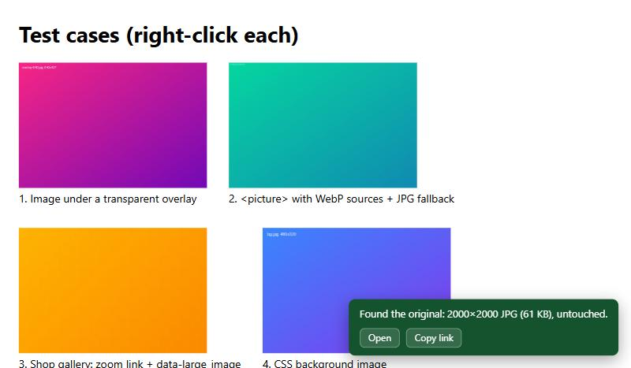
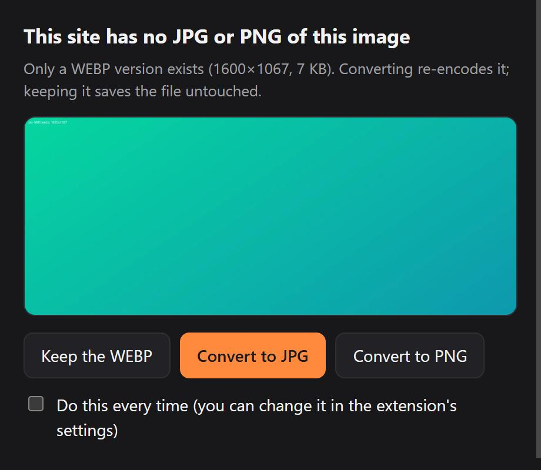
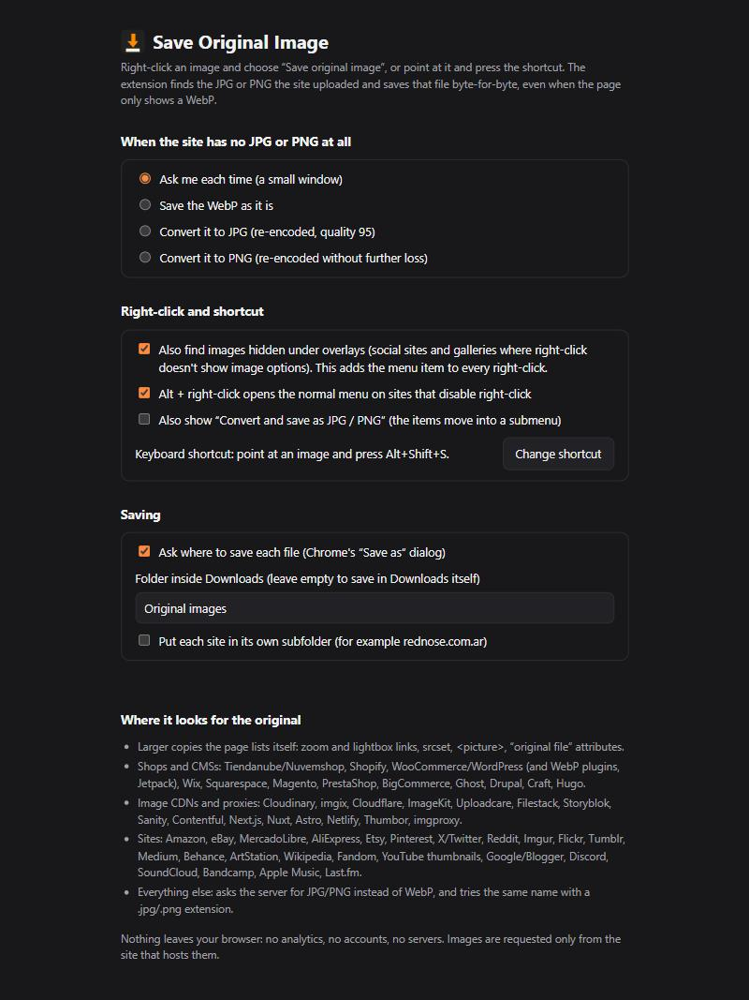

# Save Original Image

**Right-click any image to save the original JPG or PNG the site uploaded, byte-for-byte, instead of the WebP copy your browser was sent.**

Most sites now resize and re-encode their images to WebP or AVIF before showing them. "Save image as…" then gives you a small, recompressed `.webp`. The original file is usually still on the server, at a slightly different address. This extension knows where 60+ shops, CMSs, image CDNs and websites keep it, finds it, and saves it untouched.



On a real Tiendanube product page, for example, Chrome shows a **640×800 WebP (66 KB)**; the extension saves the **3544×4430 JPG (7.0 MB)** the shop uploaded.

## Features

- **The real original, never re-encoded.** It saves the exact bytes the site stored. No canvas, no quality loss.
- **60+ platforms built in**, plus whatever the page itself lists (zoom links, `srcset`, `<picture>`, "original file" attributes). See [the full list](#where-it-looks).
- **Images hidden under overlays.** Many sites cover their photos with a transparent layer so right-click shows no image options. Right-click anyway and choose **Save original image**: it finds the image under the cursor, including CSS backgrounds and video posters.
- **Keyboard shortcut.** Point at an image and press **Alt+Shift+S** (you can change it).
- **Alt + right-click** brings back the normal menu on sites that disable right-click.
- **Convert only as a last resort.** If a site really has no JPG/PNG, a small window asks whether to keep the WebP or convert it to JPG or PNG. It warns you when an image is animated. You can set a default choice.
- **Tidy downloads.** Optional folder inside Downloads, optionally one subfolder per site; never overwrites a file.
- **Open / Copy link** buttons on the result message, for the original's address.
- **English and Spanish**, following your browser's language.
- **Private.** No analytics, no accounts, no servers. See [PRIVACY.md](PRIVACY.md).

| When there is no original | Settings |
| --- | --- |
|  |  |

## Install

1. Download `save-original-image-<version>.zip` from the [latest release](https://github.com/davidmkk/save-original-image/releases/latest) and unzip it.
2. Open `chrome://extensions` and turn on **Developer mode** (top right).
3. Click **Load unpacked** and choose the unzipped folder.

Works in Chrome 116+ and other Chromium browsers (Edge, Brave, Opera, Vivaldi). Tabs that were already open need one reload.

## How it works

1. **Ask the page.** A content script lists every address the page has for the image: `srcset`, `<picture>` sources, zoom and lightbox links, lazy-load and "original file" attributes. For images under overlays it hit-tests the point you clicked.
2. **Ask the platform.** [`rules.js`](rules.js) turns resized addresses into original ones, for example `name-640-0.webp` → `name.jpg` on Tiendanube, or `/v1/fill/w_600…` → the bare file on Wix. Image proxies (Next.js, Cloudinary fetch, imgproxy, Optimole…) carry the original's address inside their own, so it is decoded.
3. **Ask the server.** Every candidate is requested with an `Accept` header that leaves out WebP and AVIF, the way an older browser would, so CDNs that pick the format per browser send the JPG/PNG. Only the first bytes are read to identify the file (6 requests at a time). The first real JPG/PNG/GIF wins; placeholders and tiny icons are ignored.

### Where it looks

- **Shops and CMSs:** Tiendanube/Nuvemshop, Shopify, WooCommerce/WordPress (+ WebP Express, WebP Converter for Media, EWWW/Imagify-style `.jpg.webp`, Jetpack Photon, WordPress.com), Wix, Squarespace, Magento, PrestaShop, BigCommerce, Ghost, Drupal, Craft CMS, Hugo.
- **Image CDNs and proxies:** Cloudinary, imgix, Cloudflare Images, ImageKit, Uploadcare, Filestack/Hygraph, Storyblok, Sanity, Contentful, Prismic, DatoCMS, Next.js, Nuxt Image, Astro, Netlify, Vercel, Thumbor, imgproxy, wsrv.nl, Optimole, ShortPixel, Substack.
- **Sites:** Amazon, eBay, MercadoLibre, AliExpress, Etsy, Pinterest, X/Twitter, Reddit, Imgur, Flickr, Tumblr, Medium, Behance, ArtStation, Dribbble, Unsplash, Pexels, Wikipedia/Wikimedia, Fandom, YouTube thumbnails, Google/Blogger, Discord, SoundCloud, Bandcamp, Apple Music, Last.fm, GitHub images.
- **Everywhere else:** the `Accept` trick, the same name with `.jpg`/`.png`, and the address without resize parameters.

Checked live against real pages (October 2026): Tiendanube, Shopify, Next.js, Ghost, WordPress, Wix, Squarespace, Wikimedia, Cloudinary, Unsplash, Pexels, YouTube. The other rules follow each platform's documented or observed URL format; if one stops working, please [open an issue](https://github.com/davidmkk/save-original-image/issues) with an example image address.

## Limits

- If a site only stores WebP/AVIF, there is no JPG/PNG to find. You get the choice window.
- Signed addresses (some social networks, private S3 links) can't be rewritten; the extension still picks the largest size the page offers.
- Images drawn on a `<canvas>` aren't files, so they can't be saved this way.
- It saves what your browser can already load. It does not get around logins, paywalls or DRM.

Respect the rights of the people who made the images: saving for personal reference is one thing; republishing needs permission.

## Development

No build step and no dependencies: the folder is the extension.

```bash
npm test                          # 75 offline tests: URL rules, ordering, header parsing, translations
node tests/live.mjs               # real sites: what Chrome shows vs. what the extension saves
python -m http.server 8766        # then, in another terminal:
node tests/background.harness.mjs # full flow with a fake chrome API: menu, shortcut, folders, choice window
npm run build                     # dist/save-original-image-<version>.zip
```

`tests/fixture.html` is a page with the tricky cases (overlay, `<picture>`, zoom link, CSS background, `pointer-events: none`, a right-click blocker) to try by hand.

Pull requests are welcome; by sending one you agree to the contribution terms in [LICENSE](LICENSE).

**Adding a platform:** add a rule to `RULES` in [`rules.js`](rules.js) (a function that receives the URL and calls `add()` with guesses, most likely first) and a line with a real example to `STRONG` in [`tests/rules.test.js`](tests/rules.test.js). Wrong guesses are cheap: each costs one failed request.

Pushing a tag like `v2.2.0` runs the tests, builds the zip and publishes a GitHub release.

## En español

**Guardar imagen original**: clic derecho en cualquier imagen para guardar el JPG o PNG original que subió el sitio, byte por byte, en lugar de la copia WebP. Conoce más de 60 tiendas, CMS, CDN y sitios (Tiendanube, MercadoLibre, Shopify, WordPress, Wix y más), encuentra imágenes tapadas por capas, tiene atajo de teclado (Alt+Shift+S) y solo convierte a JPG/PNG si el sitio no tiene ningún original, y te pregunta antes. La interfaz está en español cuando Chrome está en español.

Instalación: descarga el `.zip` de la [última versión](https://github.com/davidmkk/save-original-image/releases/latest), descomprímelo, abre `chrome://extensions`, activa el **Modo de desarrollador** y elige **Cargar descomprimida**.

## License

© 2026 David Kurt. All rights reserved. **Source-available, not open source:** you can install and use the extension for free (personal or work), read the code, and fork it here to send improvements. You may not publish it, or a modified version, in the Chrome Web Store or any other store or site without written permission. See [LICENSE](LICENSE).

Licencia: uso gratuito y código visible, pero no se permite publicarla ni redistribuirla (tampoco versiones modificadas) en tiendas de extensiones u otros sitios sin permiso del autor.
